# 積み算

積み算：https://graduation-app-kjas.onrender.com/

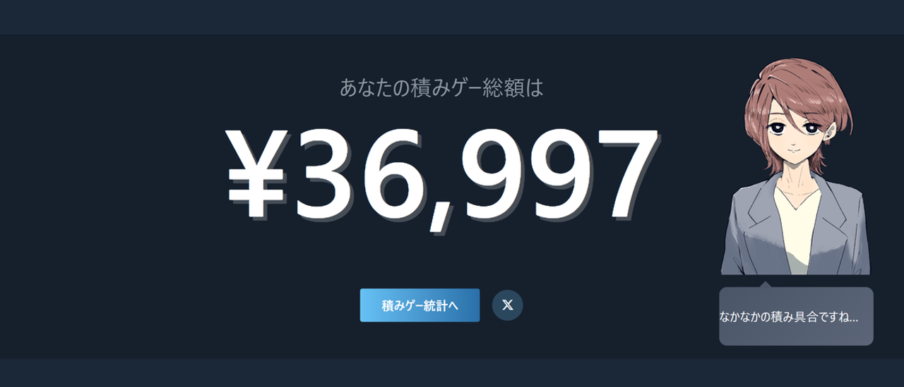

## サービス概要

- Steamライブラリにある積みゲーを金額換算した視覚情報と、次にプレイするゲーム提案機能による積みゲーの消化促進、
  および積みがちなゲーム傾向を示すことで購買行動の最適化を目的としています。※

- 誰の: Steamを利用していて、セールのたびにゲームを買っては積んでしまう社会人ゲーマー
- どんな課題を: 積みゲーによる罪悪感と選択肢疲れ
- どう解決するか: 金額で可視化 + 次にプレイするゲームの提示 + キャラとの交流で消化を促進

※補足
- Steamは主にPCゲームなどのダウンロード販売等を目的としたプラットフォームです。
- 積みゲーは広義に「購入したがプレイしていないゲーム」を指す言葉です。プレイする時間が取れないなどの理由で積まれることがあります。

---

## 開発背景

### きっかけとなった体験・感情

- 私自身がゲームを積んでしまいがちで、ぼんやりと罪悪感を感じることが多くあります。
- その原因は、セールに惹かれてプレイすることよりも買うことが目的になってしまうことがあるためだと感じています。
- ライブラリが肥大化するにつれ選択肢が増えすぎてしまい、本来やりたかったゲームに手が付けられない状態に陥ってしまうことがありました。

- この罪悪感に強制的に目を向けさせつつ、解消するための動機付けを行ってくれる外部アプリを作成したいと考えました。

---

### なぜそれが「気になった」のか

- 積みゲー自体が悪とは思いませんが、可処分所得や時間が限られる社会人ゲーマーにとって無駄遣いや、
  プレイしないゲームのライブラリを眺めて時間をつぶしてしまうことは不本意であると考えています。

- また、私は積みゲーを消化しようとゲームを起動したはいいものの、
  実際にゲーム画面を見ると気持ちがそがれてしまうことが多くあります。
  これはストーリーや操作を思い出すコストが、「積みゲーを消化したい」という気持ちを上回っているためと考えています。

- ですが同時に「積みゲーの再開」という最初の障壁さえ突破できれば、
  あとはゲーム本来の面白さに引き込まれて完走できることもあると知っています。

- このアプリは義務感を与えてゲームをプレイさせることが目的ではありません。
  積みゲーを消化する動機づけ強化のために購入総額を可視化し、ある種の痛みとしての自覚に加えて、
  積みゲーを消化したこと自体に対する外部的な報酬を設定することでプレイのきっかけを強化することを目的としたアプリです。

---

## 主な機能

### 積みゲー総額算出機能
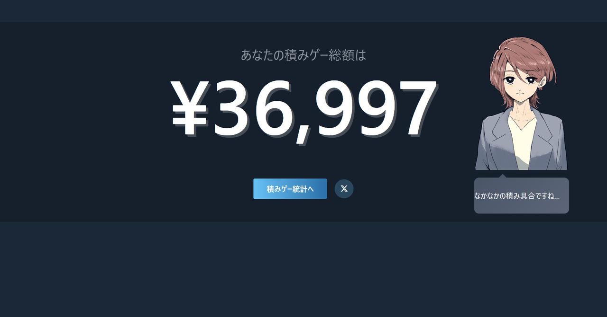

一定の基準に沿って積みゲーと判定されたゲームの定価合計額を算出して表示する機能です。
積みゲー判定基準は「プレイ時間が2時間以下」かつ「直近1か月プレイされていない」かつ「未クリア」のすべてを満たしていることです。積みゲー総額に応じてキャラクターのセリフが変動します。

### 積みゲー統計
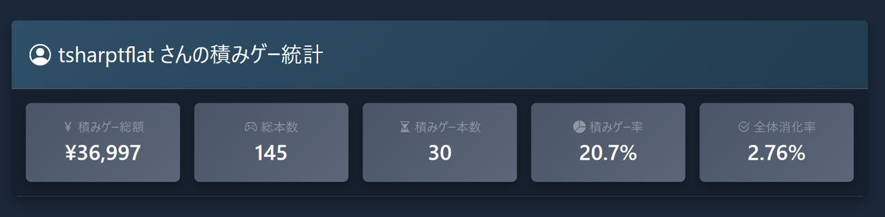

所持ゲームの合計本数や、そのうち積みゲー判定となっているゲームの本数など簡単な統計情報の表示です。

### 積み状況推移記録機能
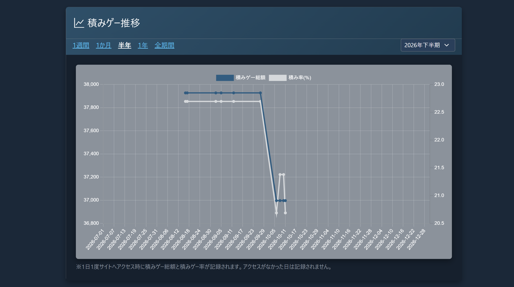

積みゲー総額と積みゲー率（所持ゲームのうち、何パーセントが積みゲー判定となっているか）を、日付を横軸としたグラフで記録表示する機能です。ログインしていない日は記録せず、ログインした状態でアクセスした日にのみ記録する仕様としております。ログインしない日にも記録する設計にすることも検討しましたが、ログインしていない日も自動記録にすると、非アクティブユーザーを含む全ユーザー分に比例してコストが増えてしまうため実装時点では見送りとしました。しかし当然ログインしていない間の変動は記録されないという弱みがあるため、改善するとしたら直近でアクセスしたユーザーに絞って毎日自動で記録し、一定期間以上ログインがなかったアカウントについては記録を停止する、といった方向性で考えています。

### 積みゲー各種情報確認機能
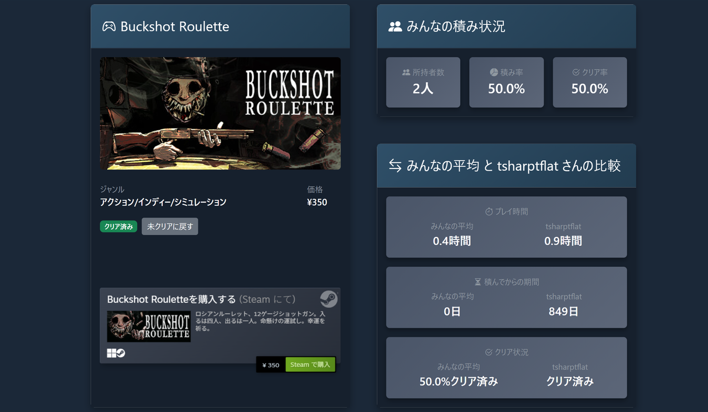

ゲーム毎の詳細情報を確認できる画面です。ユーザーの所持ゲームだけでなく、データベースに登録されたすべてのゲームの詳細を閲覧することができます。ゲーム毎の価格情報やストアへのリンク、ユーザー全体における積み率や、自分と自分以外のユーザーの比較などの情報を載せています。ゲーム毎のクリアフラグは手動で立てる必要があるため、合わせて「クリア済みにする」ボタンを設置しています。

### 積みゲー一覧/コスパランキング
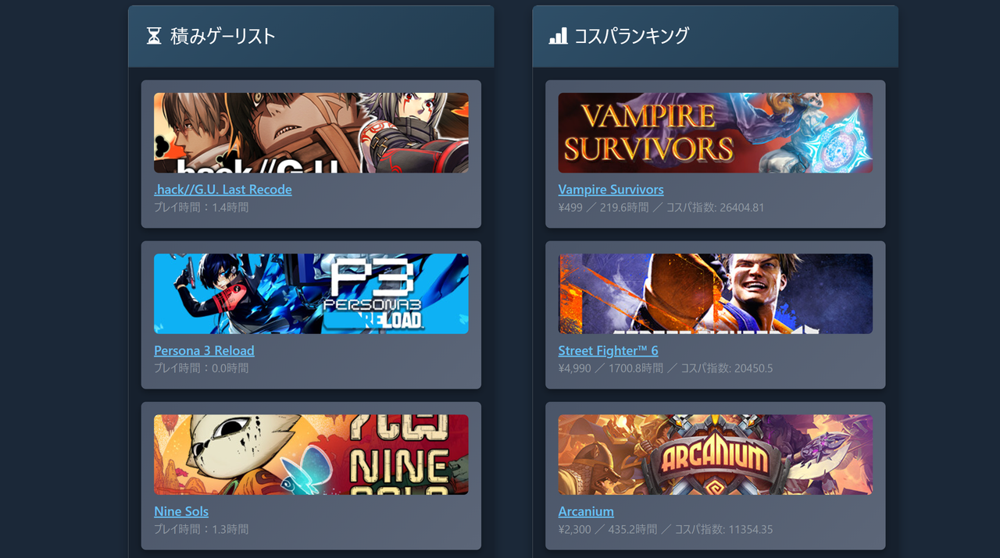

- プレイ時間/ゲームの定価 という式で算出したユーザーごとのゲームコスパランキングを閲覧できる機能です。ゲームの価格が安く、プレイ時間が長いほどコスパが高いという意図になります。

`app/models/user_game_library.rb`
```ruby
def self.cost_performance_ranking(user)
  ranked = user.user_game_libraries.includes(:game).joins(:game).where.not(games: { price: nil }).where('games.price > 0').sort_by{ |library| -((library.minutes_played + 1).to_f / library.game.price)}
  {
    best: ranked.first(COST_PERFORMANCE_RANKING_LIMIT),
    worst: ranked.last(COST_PERFORMANCE_RANKING_LIMIT).reverse,
    all: ranked
  }
end
```

- 価格が0のものは除外（0除算回避のため。また、無料ゲームは課金要素があるものがほとんどですが、課金額まで把握することが不可能なため）
- プレイ時間が0（未プレイ）のものをそのまま式に入れると価格に関わらずコスパ指数が0になってしまうため、一律でプレイ時間に1分加算しています。これによってプレイ履歴のあるゲームにはほとんど影響を出さずに未プレイのものも正しい順位を算出することができます

### 現在プレイ中・次にプレイするゲーム設定機能
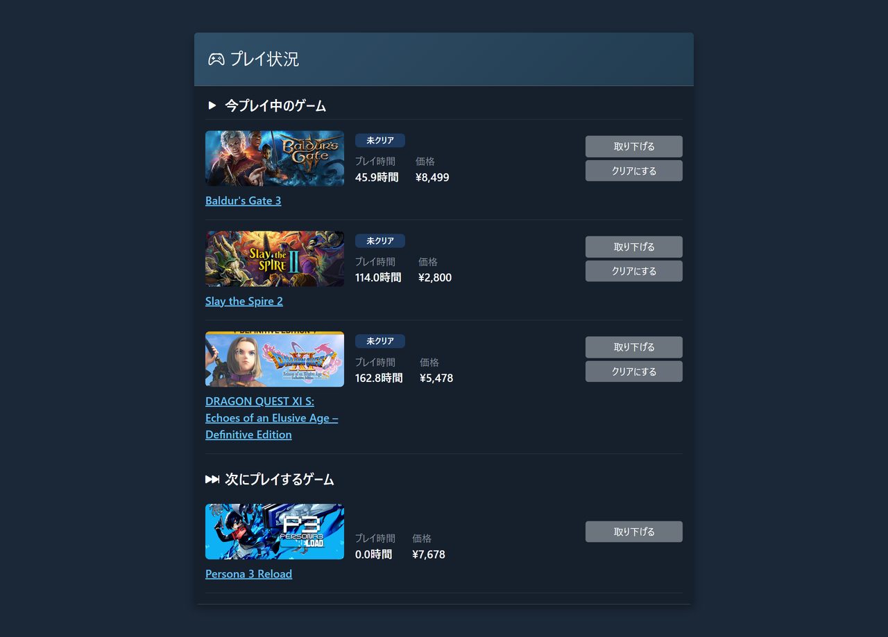

- 現在プレイ中のゲームを3つまで、次にプレイ予定のゲームを1つまで設定することができる機能です。

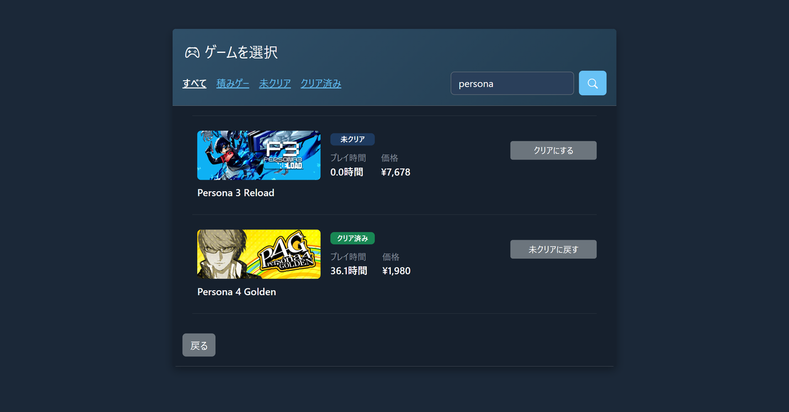

- ゲーム選択画面ではフィルタ機能と、検索結果をリアルタイム反映する検索機能を実装することでUXの向上を図っています。

### オリジナルキャラクターとの交流機能
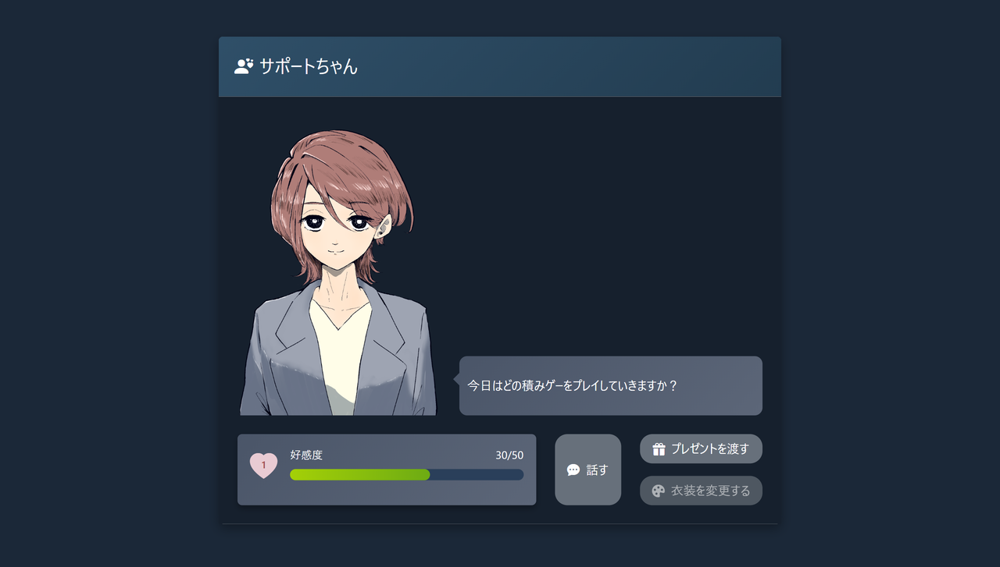

- オリジナルキャラクターとの交流機能です。「話す」ボタンを押すとキャラ固有のセリフがランダムで表示されます。

### キャラクターへのプレゼント機能
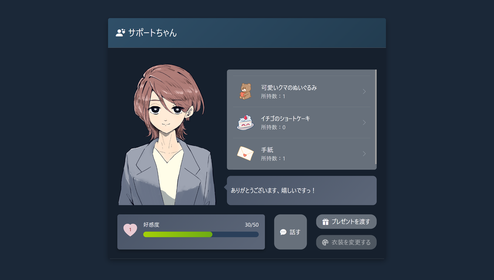

- 条件で獲得できるポイントを利用して購入できるアイテムをプレゼントすることができる機能です。プレゼントを渡すことで固有のセリフが表示され、アイテムごとに設定されている値分好感度が上昇します。

### キャラクターへのプレゼント機能、アイテムがない場合
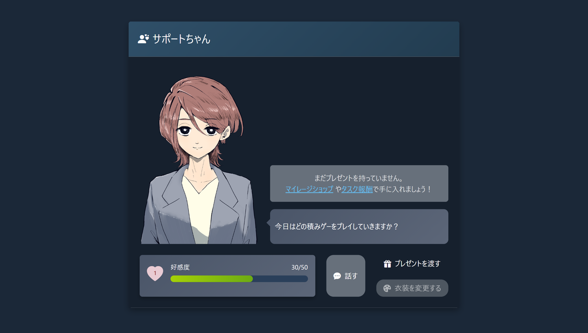

- 「プレゼントを渡す」ボタンを押した際に所持アイテムがない際はマイレージ確認画面および交換画面への導線が表示されます。

### ポイント獲得機能
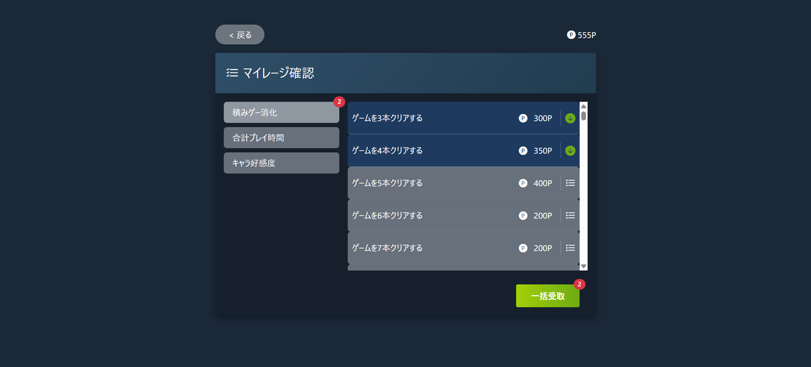

- 主にゲームのクリア本数や総プレイ時間などに応じてポイントを獲得できる機能です。
- 条件が達成されたタスクの色やアイコンを変更したり、達成済みのタスクの合計数を各所に表示させることでUXの向上を図っています。

### ポイント交換機能
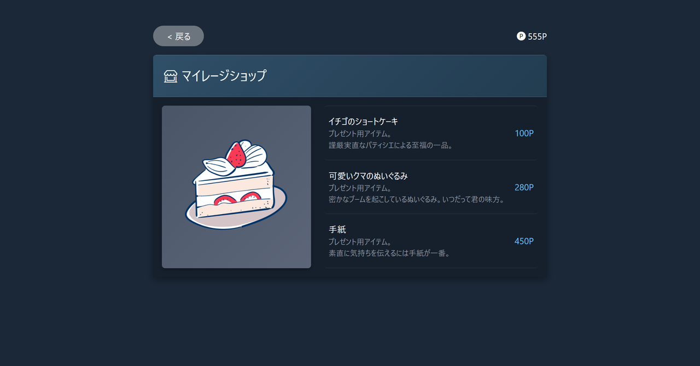
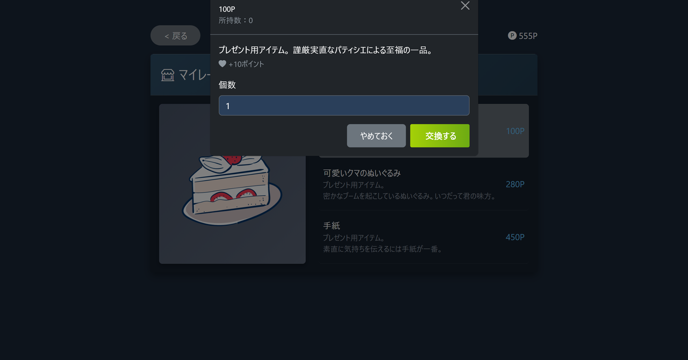

- 獲得したポイントを使用して各種アイテムと交換することができる機能です。
- 購入処理をtransactionで囲うことで、通信エラーなどで処理が失敗してしまった場合に、ポイントが消費されているのにアイテムが入手できていない といった現象が発生しないようにしています。
- 実装当初はポイントの減算処理を`possessed_user_points.decrement!`で実装していましたが、機能確認時にポイント残高が足りない場合でも購入処理ができてしまうことが判明しました。これはRailsの仕様上`decrement!`では`UserWallet`に設定しているバリデーションを通らずに直接DBの値を書き換えてしまうことが原因だったため、必ずバリデーションを通る`update!`に変更することで残高が足りない場合にはエラーで止まるようにしています。

`app/models/shop_item.rb`
```ruby
possessed_user_points.update!(point: possessed_user_points.point - total_shop_items_price)
```

---

## 使用技術

| カテゴリ | 技術 |
| --- | --- |
| フロントエンド | ・turbo-rails / stimulus-rails：Hotwire、リアルタイム画面更新<br>・slim-rails：テンプレートエンジン<br>・bootstrap：CSSフレームワーク<br>・使用ライブラリ（JavaScript）：<br>　・@hotwired/turbo-rails / @hotwired/stimulus：Hotwire<br>　・chart.js：積みゲー推移グラフ<br>　・bootstrap / bootstrap-icons<br>　・esbuild：JSバンドル<br>　・sass / postcss：CSSビルド |
| バックエンド | ・フレームワーク：Ruby on Rails<br>・sidekiq / redis：非同期ジョブ処理（Steam Store APIからの価格・ジャンル取得等）<br>・ransack：検索機能<br>・kaminari：ページネーション<br>・ruby-vips：OGP画像生成<br>・meta-tags：OGP/SEOメタタグ<br>・rexml / httparty：Steam Web API・Steam Store APIとの通信<br>・Steamworks WebAPI<br>・Steam Store API（非公式・コミュニティで広く利用されているエンドポイント）<br>　・ゲームの定価取得に使用<br>　・公式ドキュメントは存在しないが、多くの開発者に利用されている |
| データベース | ・DB：PostgreSQL（ホスティング：Neon） |
| 認証 | ・devise / omniauth-steam / omniauth-rails_csrf_protection：Steam OpenID認証<br>・OpenID |
| 環境構築 | ・Docker / Docker Compose|
| CI/CD | ・|
| インフラ | ・デプロイ先：Render<br>・cloudinary：画像配信 |
| その他 | ・rspec-rails / factory_bot_rails：テスト<br>・rubocop-rails-omakase：Lint<br>・brakeman：セキュリティスキャン<br>・bullet：N+1クエリ検出<br>・annotate：モデルへのスキーマ情報自動追記<br>・pry-rails：開発時のデバッグ |

---

## 技術選定理由

### 【バックエンド】
#### UX向上のため
- 本アプリはログイン後のページでユーザーの積みゲー総額を表示する設計になっております。
- 積みゲー総額の算出にはユーザーの所持ゲーム情報の取得・更新の必要があるため、処理がすべて終わって初めてページ遷移が行われる形になります。
- しかしユーザーごとのライブラリ取得は1度のAPI呼び出しで取得・更新が済む一方で、ゲーム毎の価格取得は1本毎に呼び出しが必要になります。
- そのため所持ゲーム本数が多いほどページ遷移に時間がかかることになってしまう事態を避けるため、ゲームごとの情報取得のみ切り分けて非同期化し、総額表示を保留しつつページ遷移のみ先んじて完了させる設計とするためにSidekiqとRedisを採用しました
- 本番環境でSidekiqを動かすにはWebとは別の有料サーバー（Background Worker）が必要でした。非同期化させずにジョブをその場で実行させることで無料で済ませることも可能でしたが、上記の待ち時間発生回避のためにコストをかける判断をしました。

### 【データベース】
- PostgreSQLでは公式のDockerイメージが用意されており、環境構築に採用しているDockerとの相性が良いため採用しております。
- またRenderの無料枠でPostgreSQLを作成した場合、作成から30日でDBが削除されてしまいますが、これを回避するためにそういった期限のないNeonをホスティング先に使用しております。

### 【認証】
- OpenIDの話

### 【環境構築】
- Dockerの話


- 学習してきたRailsの技術を活かし、開発スピードを重視したため選定しています。
- SteamのOpenID連携を使用することでセキュリティリスクを減らし、かつアカウント作成の手間を削減しています。
- Steamユーザーのライブラリおよび各ゲームのプレイ状況を取得する必要があるため、Web API連携を選定しています。

- 今回チャレンジしたい点：
  - OpenIDの仕組み理解及び実装
  - Steam連携におけるユーザーライブラリやプレイ状況および定価、また可能であれば各ゲームにおける最安値の取得に伴う複数APIの組み合わせ

- 不安な点
  - ユーザーのsteam所持ゲーム本数が多い場合の情報取得における効率的な実装ができるか


### フロントエンド
- bootstrap
- turbo-rails / stimulus-rails：Hotwire、リアルタイム画面更新
・使用ライブラリ（JavaScript）：
　・@hotwired/turbo-rails / @hotwired/stimulus：Hotwire

- ゲーム価格取得中の「計算中…」表示から価格取得が完了したときの表示更新や、キャラクターのセリフ表示更新など、画面全体の更新を挟まずに一部の表示を変更させたい処理複数存在するため、turbo-railsとstimulus-railsを採用しました。

### バックエンド
- ・フレームワーク：Ruby on Rails

- ・sidekiq / redis：非同期ジョブ処理（Steam Store APIからの価格・ジャンル取得等）

- ・rexml / httparty：Steam Web API・Steam Store APIとの通信
・Steamworks WebAPI
・Steam Store API（非公式・コミュニティで広く利用されているエンドポイント）

### データベース
- DB：PostgreSQL（ホスティング：Neon）

### 認証
- devise / omniauth-steam / omniauth-rails_csrf_protection：Steam OpenID認証<br>・OpenID

### 環境構築
- Docker

### CI/CD
- 

### インフラ
- デプロイ先：Render<br>・cloudinary：画像配信

### その他 いらないかも
- bullet：N+1クエリ検出<br>・annotate：モデルへのスキーマ情報自動追記<br>・pry-rails：開発時のデバッグ

---

## インフラ構成図

<!-- TODO: インフラ構成図 -->

---

## ER図

https://gyazo.com/5a13f0ed00763b0e789691848377097c

---

## 工夫したポイント

<!-- TODO: 工夫したポイント -->

---

## 画面遷移図

Figma:
https://www.figma.com/design/jpYQM16kqOQ2w9d3J5h353/%E7%94%BB%E9%9D%A2%E9%81%B7%E7%A7%BB%E5%9B%B3?node-id=2-1380&t=TQUh9pKaQL3aBRBF-4

---

## セットアップ手順 / 開発環境構築

<!-- TODO: セットアップ手順・開発環境構築方法 -->

---

## 今後の予定

<!-- TODO: 今後の予定 -->

---

## 企画段階の設計

### 課題の整理（表面的になっていないか）

#### 表に見えている困りごと

- お金を無駄にしていること
- 「ゲームを購入すること」が目的化してしまっていること

---

#### 本当に解決したい課題は何か

- ゲームライブラリに「特にプレイしたいわけではないゲーム」が増えてしまう
- 選択肢疲れによりゲームをプレイすることからすら離れてしまうことがある
- 本来プレイしたいゲームがプレイできなくなってしまう

→ 本当に解決したい課題：無駄な購入による選択肢疲れをなくしたい

---

### 想定ユーザーについて

#### 想定しているユーザー

年齢設定：
  - 年齢：20代～40代
  - 理由：可処分所得や時間が限られている社会人ゲーマーに使用してもらうことを想定しているため

生活・状況設定：
  - 生活・状況：steamの大型セール時などに次に購入するゲームを検討しているとき
  - 理由：その人にとって最適な購入意思決定を促すため

環境設定：
  - 環境：PCやスマホでSteamの膨大な商品/所有リストを閲覧している環境
  - 理由：次にプレイするべき積みゲーを提示してあげるため

---

#### 自分とユーザーの距離

- 自分自身
- 理由：私自身、積みゲーからくる罪悪感や選択肢疲れにより不快感を感じているため

---

#### 実際に使われる可能性について(需要・存在確認)

- ゲームを積んでしまうこととそれに対する罪悪感は一つの「あるある」として広まっていて、
  かつ類似のサービスが存在しており需要は存在すると考えています。
- 最初に使うユーザーとしては私自身、および同じようにsteam上でゲームを購入して積んでいる人を想定しています。

---

#### ユーザーがサービスを導入して利用するまでのイメージ(導入・継続の流れ)

導入のきっかけ：
- 積みゲーに対する罪悪感を感じたとき
- 興味本位で積みゲー総額を見てみたいと感じたとき

利用タイミング：
- Steamのウィッシュリストを眺めてセール品の購入を検討しているとき
- ゲームを1本クリアしたり、一区切りついたりして次にプレイするゲームを決めるとき

継続利用の流れ：
- 積みゲーの総額を突き付けられるという負の動機から消化を開始
- 消化によってアプリ内ポイントを獲得し、キャラクターとの交流や着せ替えを可能にする
  - 負の動機を楽しみに変換し、積みゲーを消化する動機付けおよび継続的にアプリを利用する導線を作成する
- さらに積み/消化状況ベースの統計情報を提供することで定期的なアプリ利用のきっかけを作成する

---

### 既存サービス・競合調査

#### 似たサービスの調査

- サービス名：ツミナビ
- URL：https://tsumi-navi.vercel.app/
- どんなことができるか：
  - steamアカウントを利用したシングルサインオン、およびライブラリ等の取得
  - 積みゲーをタワーやグラフで可視化
  - ユーザー同士の積みゲーバトル
  - ゲーマーとしての傾向分析や、傾向に沿った新作のレコメンド

- 強味：
  - ゲーマー傾向から分析されたレコメンドによって「選択肢を増やす」機能
  - 積みゲーを消化しているほどボーナスが得られるバトルモードによる積みゲー消化促進

---

#### それでも自分が作りたい理由

- 積みゲーの可視化だけでなく、継続的な消化促進までつなげたいと考えています。

---

#### 差別化点

- コンセプト：
  - Steam上でゲームを積んでいて、そのことに引け目を感じながらも新しいゲームを購入してしまうゲーマーの罪悪感を解消すること、
    およびそのために積みゲー消化へ継続的に誘導することが主な目的となります。

- 機能面：
  - 本アプリは積みゲー消化促進を目的としており、積みゲーの定価総額を表示可能にします。
    ユーザーに痛みを認識してもらうことで積みゲーを再度開く1歩目を手助けします。

  - また、オリジナルキャラクターによる痛みへのフォローと、そのキャラクターとの交流という積みゲー消化を促す機能を実装したいと考えています。

  - さらに、選択肢疲れを軽減する対策として「次に遊ぶ積みゲー提案機能」および
    ユーザー傾向を分析し「積む可能性の高いゲームジャンル」を提示する機能（逆レコメンド）を実装したいと考えています。

---

### このサービスで提供したい価値

#### ユーザーの変化

このサービスを使うことで、ユーザーは以下の変化が期待できます。

- 行動の変化：積みゲーを消化したい方向に向く、積みそうなゲームの衝動買いを控える
- 気持ちの変化：購入を検討しているゲームが、本当にやりたいゲームだから買うのか、お得だから買うのかを踏まえることができる

---

#### 価値を一文で表す

「このサービスは可処分時間や所得が限られる社会人ゲーマーが積みゲーを消化し、気持ちよくゲームがプレイできるようになるサービス」

---

### このアプリで実現すること

#### MVPで作る機能
- OpenIDを使用したSteamアカウントを用いたSSO機能
- SteamworksWebAPIを使用したライブラリおよびゲーム定価の取得
- 積みゲーの定義、および積みゲーリストとその定価総額の提示
- 次にプレイするゲームの提案機能
- キャラクターによる積み状況や総額等を受けたフィードバック機能

#### 本リリースで作る機能
- 積みゲーの消化履歴や、積んでからクリアまでの時間などが確認できる 積みゲーリザルト機能
- 積みゲー消化金額・消化率ランキング機能
- ユーザーが積みがちなゲーム傾向を提示する逆レコメンド機能
- シェア機能
- オリジナルキャラクターとの交流機能
- オリジナルキャラクターとの交流を促進するポイント獲得機能

---

### このアプリの懸念点とその対策

#### 懸念点

- 一度だけの利用に終わってしまう懸念があると考えています。
  - 「積みゲー総額の提示」というその場のインパクトを与えやすい性質のアプリであるため。

#### 対策

- オリジナルキャラクターとの交流、および着せ替え機能の実装が継続的にご利用いただく動機付けとして働くことを期待しています。
  - ゲームを消化すればするほどアプリ内ポイントを獲得できる機能と、着せ替えアイテムなどと交換が可能な機能の実装を想定しています。

- 積みゲーリザルト機能
  - 積みゲーの消化履歴や、積んでからどれだけ時間が経っているかなどが確認可能なリザルト機能により、定期的に振り返りたくなる機能の実装を予定しています。
  - また、あわせて月1回など決まった周期でのみ確認可能になる自身の統計ステータスを確認できる機能の追加を検討しています。

---

### 今後の展開・発展の方向性

- ユーザーはなぜ使い続ける？：
  - 積みゲー消化具合の確認とオリジナルキャラクターとの交流のためです。

- 続けることで何が変わる？：
  - ユーザー：ゲームを積まず、自身が本当にプレイしたいゲームに絞って購入する習慣がつくことが期待できます。
  - アプリ：ユーザーごとに、より精度の高い「逆レコメンド」を提示することが可能になります。

- データが溜まると何ができる？：
  - ゲームごとに、そのユーザーが過去に積んだゲームとの類似性を算出し警告を出すことが可能になります。

- 他の人と関わる余地はある？：
  - SNS上での共有が交流につながることを期待できます。

- 運用・仕組みで価値を出せないか？：
  - オリジナルキャラクターとの交流コンテンツを更新することで価値を出すことができると考えています。
    - 例えば定期的なセリフ追加や衣装追加など。

---

#### 今考えている発展案

- 機能追加の方向性：
  - アプリ上でのユーザー同士のコミュニケーション
    - 直接的なチャット機能等ではなく、互いの積み/消化状況の閲覧やレコメンド機能

- UI・体験の改善：
  - オリジナルキャラクターとの交流コンテンツの拡充

- 機能以外の工夫：
  - 積みゲーデータの統計公開
  - SNS上でユーザー同士が積みゲーの消化状況をシェアできるようハッシュタグを作成
