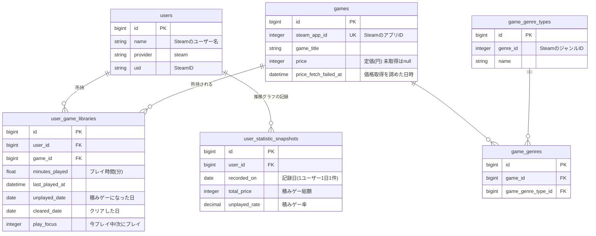
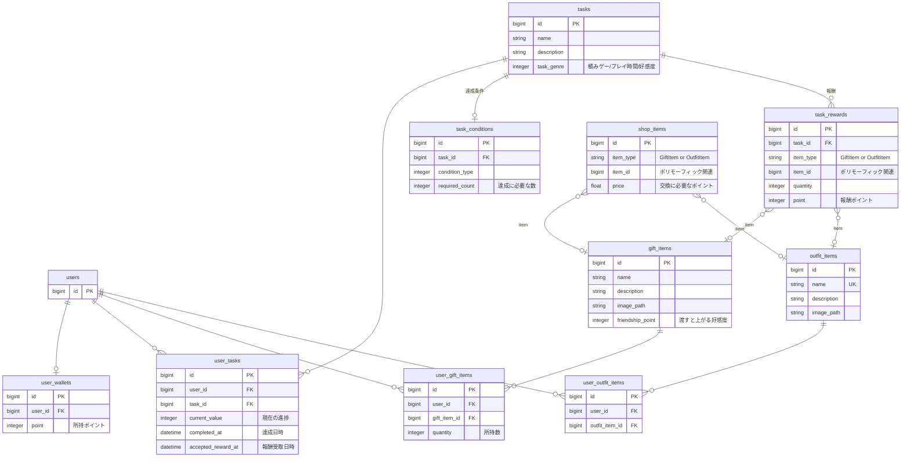
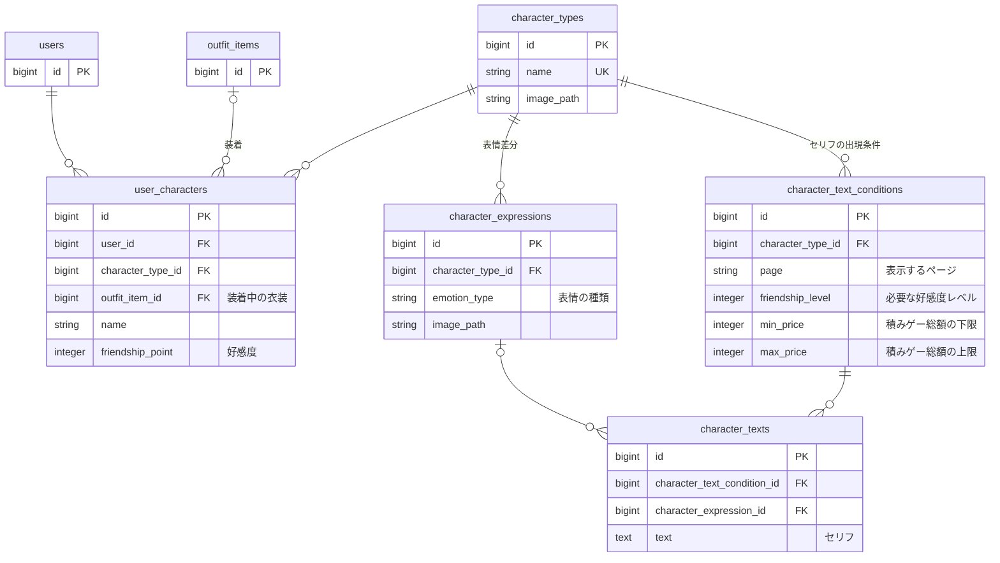

### ユーザー・ゲーム（アプリの中心）

### マイレージ（タスク・ショップ）

### キャラクター

- `created_at` / `updated_at` は全テーブル共通のため省略
- 複数の図にまたがるテーブル(`users`、`outfit_items`)は、2枚目以降では `id` のみ記載
- `task_rewards` と `shop_items` の `item` は、`item_type`(GiftItem / OutfitItem)と `item_id` によるポリモーフィック関連
- `contacts`(お問い合わせ)は他のテーブルと関連を持たないため省略
