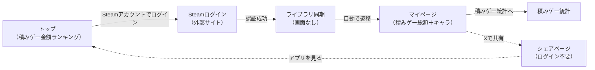
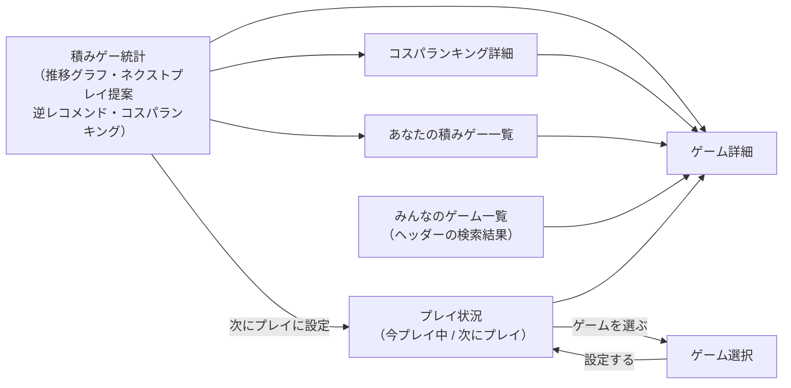
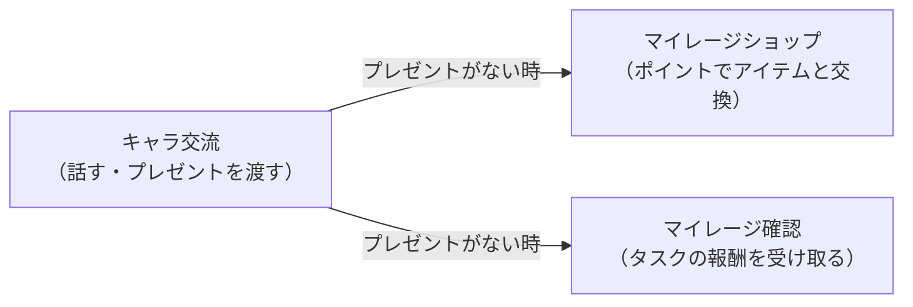

### ログインからマイページまで

### 積みゲー分析

### 積みゲーマイレージ

- ログイン後の各画面（マイページ・積みゲー統計・積みゲー一覧・みんなのゲーム一覧・プレイ状況・マイレージ確認・ショップ・キャラ交流）へは、全ページ共通のヘッダーメニューから移動できる。ヘッダーの検索では、候補からゲーム詳細へ直接移動できる
- 全ページ共通のフッターから、利用規約・プライバシーポリシー・クレジット・お問い合わせ（入力 → 確認 → 完了）へ移動できる
- 点線は、外部サービス（X）を経由した遷移
